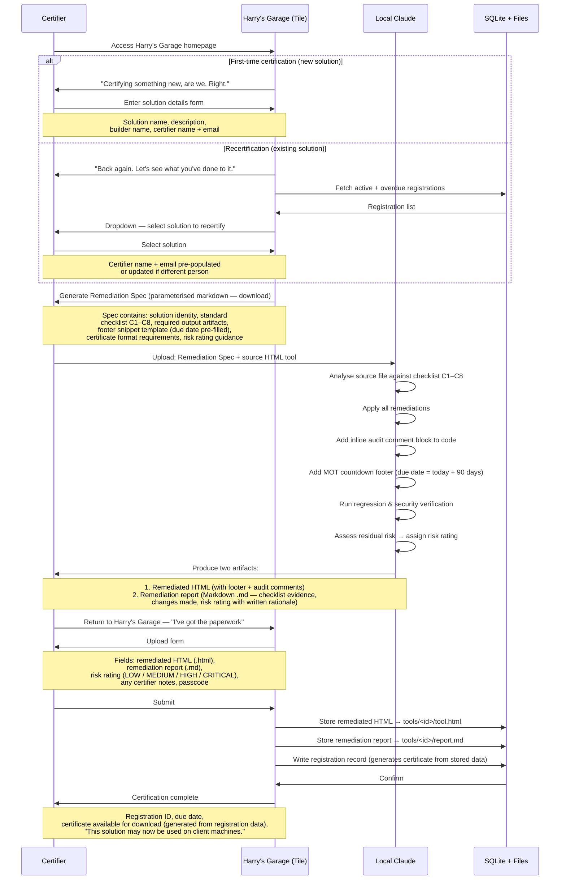

# Process Flow 01 — Remediation, Certification & Recertification
**UU Simpler Smarter Better Programme — Harry's MOT Garage**
**Version 0.1 | 2026-10-14 | Status: Draft for review**

---

## Overview

This journey covers both first-time certification of a new HTML tool and recertification of an existing registered tool. The two paths share a common flow; they diverge only at the entry point (how solution identity is established) and converge again at the Remediation Spec delivery step.

**Key architectural constraint:** All AI computation happens in the builder's local Claude instance. Harry's Garage (the hosted Tile solution) is deterministic throughout — it generates templates and stores artifacts, but does not call an AI model.

---

## Actors

| Actor | Description |
|---|---|
| **Builder** | The person who originally wrote the HTML tool |
| **Certifier** | The person submitting it for certification — may be the same as the builder or different (e.g. a team lead certifying a colleague's work) |
| **Harry's Garage** | The hosted Tile application (deterministic — no AI) |
| **Local Claude** | The certifier's local Claude instance (claude.ai or Claude Code) — where all AI computation happens |
| **SQLite + Files** | Tile-hosted storage — catalog database and file artifacts |

---

## Sequence Diagram

---

## Step-by-Step Detail

### Phase A — Entry (Harry's Garage)

| Step | Actor | Action | System response |
|---|---|---|---|
| A1 | Certifier | Accesses Harry's Garage | Homepage shown. Harry greets. Two options: "New certification" / "Recertification" |
| A2a | Certifier | Selects "New certification" | Form shown — go to A3 |
| A2b | Certifier | Selects "Recertification" | Dropdown of active/overdue registered solutions shown — go to A4 |
| A3 | Certifier | Completes new solution form: solution name, short description (1–2 sentences, shown in admin view), builder name, certifier name, certifier email | Form validated. Certifier email auto-populated from `tile.role().email` if available |
| A4 | Certifier | Selects existing solution from dropdown | Solution details pre-populated. Certifier updates their name/email if different from original certifier |
| A5 | Harry's Garage | Generates Remediation Spec | Parameterised markdown file with solution identity baked in. Served as download |

### Phase B — Local Remediation (Certifier's machine)

| Step | Actor | Action | Notes |
|---|---|---|---|
| B1 | Certifier | Opens local Claude (claude.ai or Claude Code) | No platform-specific requirement — must work on both |
| B2 | Certifier | Uploads Remediation Spec + source HTML to Local Claude | Both files together in one message/session |
| B3 | Local Claude | Reads spec, analyses source HTML | Runs static scan equivalent to Security-Remediation-Checklist.md C1–C8 |
| B4 | Local Claude | Applies all required remediations | Per Remediation-Process.md: CDN removal, CSP, XSS fixes, etc. |
| B5 | Local Claude | Adds inline audit comment block | In-code evidence trail: what was changed and why |
| B6 | Local Claude | Adds MOT countdown footer | Due date = session date + 90 days, hardcoded into snippet |
| B7 | Local Claude | Runs regression & security verification | Playwright where available; static checks always |
| B8 | Local Claude | Assesses residual risk | Considers: unremediated items, deferred risk, complexity. Assigns LOW / MEDIUM / HIGH / CRITICAL with written rationale |
| B9 | Local Claude | Produces two outputs | (1) Remediated HTML (with footer + audit comments), (2) Remediation report as markdown (.md) — includes checklist results, changes made, risk rating with written rationale |

### Phase C — Registration (Harry's Garage)

| Step | Actor | Action | System response |
|---|---|---|---|
| C1 | Certifier | Returns to Harry's Garage, selects "Upload my results" | Upload form shown |
| C2 | Certifier | Uploads remediated HTML (.html only) | File validated |
| C3 | Certifier | Uploads remediation report (.md only) | File validated — markdown produced by Local Claude |
| C4 | Certifier | Enters risk rating (LOW / MEDIUM / HIGH / CRITICAL) | Dropdown — value generated by Local Claude in B8, certifier confirms |
| C5 | Certifier | Enters passcode | Write-access control — programme process gate |
| C6 | Certifier | Submits | Validated |
| C7 | Harry's Garage | Stores files, writes registration record, generates certificate from registration data | Due date = today + 90 days |
| C8 | Harry's Garage | Shows completion screen | Registration ID, due date, certificate download link, Harry's sign-off line |

---

## Data Captured

| Field | Source | Captured at |
|---|---|---|
| Registration ID | Generated (UUID) | C7 |
| Solution name | Certifier input / pre-populated | A3 / A4 |
| Solution description | Certifier input | A3 |
| Builder name | Certifier input | A3 |
| Certifier name | Certifier input / `tile.role()` | A3 / A4 |
| Certifier email | `tile.role().email` (validated) | A3 / A4 |
| Risk rating | Local Claude → certifier input | C4 |
| Registered at | Auto (ISO date) | C7 |
| Next due at | Auto (registered_at + 90 days) | C7 |
| Remediated HTML file key | File storage | C7 |
| Remediation report file key | File storage (.md) | C7 |
| Is recertification | Flag (0/1) | C7 |
| Previous registration ID | Linked from dropdown selection | C7 |

---

## Remediation Spec — Contents

The spec is a parameterised markdown template generated by Harry's Garage. It contains no AI — it is a template with the solution's identity substituted in. Contents:

1. **Header**: Solution name, certifier, date, certification type (new / recertification)
2. **Instructions for Local Claude**: Role framing, what to do, what not to do
3. **Checklist C1–C8**: Full remediation checklist verbatim from `Security-Remediation-Checklist.md`
4. **Output requirements**: Exact format of the three artifacts to produce
5. **Footer snippet template**: With due date pre-filled (`today + 90 days`)
6. **Risk rating guidance**: Definition of LOW / MEDIUM / HIGH / CRITICAL; instructions to produce a rationale
7. **Verification instructions**: What regression tests to run before declaring complete

---

## Decisions

| # | Question | Decision |
|---|---|---|
| OQ1 | Can the certifier be different from the builder for a recertification? | **Yes — allowed.** Preferred: the owner self-certifies (accountability sits with ownership). Accepted fallback: a PMO certifier certifies on behalf of the owner (e.g. bulk remediation pass). Both builder and certifier are always recorded separately. |
| OQ2 | For recertification: must the HTML be the same file (re-run on existing) or can it be a new version? | **Allow new version** — tools commonly evolve between certification cycles |
| OQ3 | What happens if Local Claude is unavailable or the certifier doesn't use Claude? | **Out of scope for v1.** The process assumes a local Claude instance (claude.ai or Claude Code). Manual evidence path is a v2 consideration |
| OQ4 | Should the Remediation Spec vary between new certification and recertification? | **Minor variation** — recertification spec includes previous cert date and prompts Claude to note what has changed since last certification |
| OQ5 | How is the passcode communicated to certifiers? | **Out-of-band** — programme lead distributes it. It is not stored in or displayed by the app |
| OQ6 | Certificate format: PDF upload or system-generated? | **System-generated.** Certifier uploads HTML + markdown report only. Certificate is generated by the hosted solution from registration data and is downloadable as a print-to-PDF at any time. Eliminates PDF processing on upload. |
| OQ7 | Ownership transfer (joiners/movers/leavers)? | **Deferred to v2.** V1 records builder and certifier but has no transfer journey. Anyone with the passcode can certify or retire any solution. |
