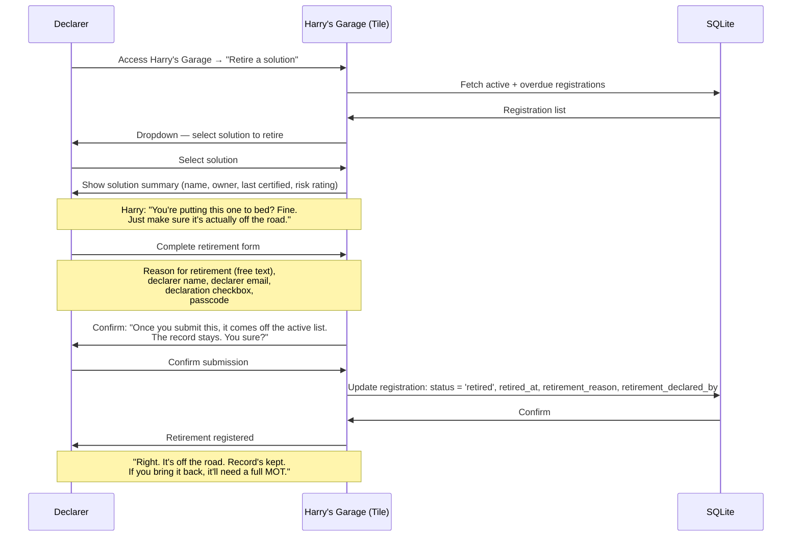

# Process Flow 02 — Solution Retirement
**UU Simpler Smarter Better Programme — Harry's MOT Garage**
**Version 0.1 | 2026-10-14 | Status: Draft for review**

---

## Overview

When an HTML tool is no longer in use on client machines, the owner or programme lead registers its retirement. This removes it from the active certification list (stopping unnecessary recertification cycles) while retaining the full audit record for compliance purposes.

The retirement journey is a declaration, not a technical process. No remediation or AI is involved. The certifier confirms that the solution is no longer deployed and accepts responsibility for that statement.

---

## Actors

| Actor | Description |
|---|---|
| **Declarer** | The person registering the retirement — typically the solution owner, builder, or programme lead |
| **Harry's Garage** | The hosted Tile application (deterministic) |
| **SQLite** | Catalog database — retirement is a status update, not a delete |

---

## Sequence Diagram

---

## Step-by-Step Detail

| Step | Actor | Action | System response |
|---|---|---|---|
| R1 | Declarer | Accesses Harry's Garage, selects "Retire a solution" | Harry: brief in-character prompt. Dropdown of active/overdue solutions shown |
| R2 | Declarer | Selects solution | Solution summary shown: name, builder, last certification date, risk rating, current status |
| R3 | Declarer | Completes retirement form: reason, name, email | Free-text reason (e.g. "Project ended", "Replaced by v2", "Scope change") |
| R4 | Declarer | Checks declaration: "I confirm this solution is no longer deployed on client machines and will not be redeployed without a new certification" | Required — cannot submit without it |
| R5 | Declarer | Enters passcode | Same write-access gate as certification |
| R6 | Harry's Garage | Confirmation prompt before submit | Plain English — destructive-ish action, user must confirm |
| R7 | Declarer | Confirms | — |
| R8 | Harry's Garage | Updates registration record: status = 'retired' | Does **not** delete the record. Files remain in storage. Audit trail intact |
| R9 | Harry's Garage | Completion screen | Harry's line: "Off the road. Come back if it ever needs another run." |

---

## Data Captured

| Field | Value |
|---|---|
| `status` | `'retired'` |
| `retired_at` | ISO date (auto) |
| `retirement_reason` | Free text (declarer input) |
| `retirement_declared_by` | Declarer name + email |

---

## Behaviour in Catalog After Retirement

- **Active view (The Board default):** Retired solutions are **hidden**. The active list becomes shorter — this is the point.
- **Audit view (toggle or export):** Retired solutions are **included**. Full history visible, with retirement reason and date.
- **Re-certification:** If a retired solution needs to come back, it must go through a full new certification (Journey 1, new path). The previous registration is referenced as lineage but the new one starts from scratch.

---

## Decisions

| # | Question | Decision |
|---|---|---|
| OQ1 | Who can retire a solution — the original owner only, or any passcode holder? | **Any passcode holder.** The original owner may have left the project. Accountability is captured by the declaration and the declarer's name/email on record. |
| OQ2 | Should there be an optional file upload for retirement evidence? | **No for v1.** Declaration checkbox is sufficient. |
| OQ3 | Should retirement trigger a notification? | **Out of scope for v1.** No email/notification service available on Tile. |
| OQ4 | Ownership transfer — can a solution owner reassign ownership before leaving? | **Deferred to v2.** V1 has no transfer journey. The workaround is that any passcode holder can retire or recertify. A light-touch movers/leavers path (dropdown to reassign builder name) is a v2 candidate. |
