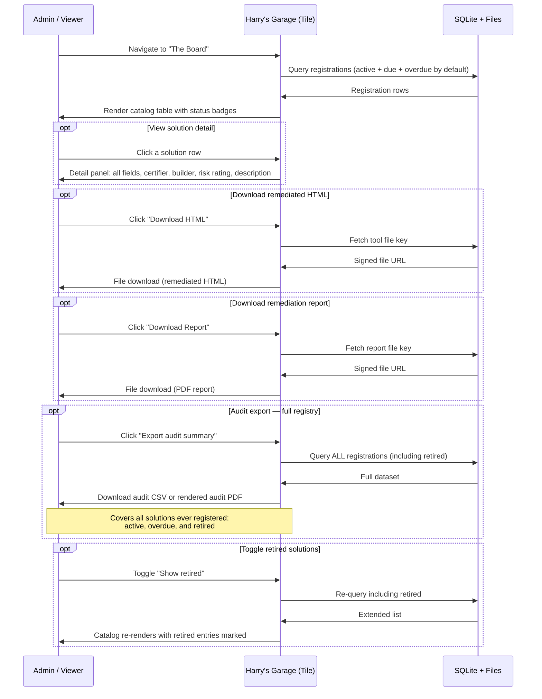

# Process Flow 03 — Admin Catalog (The Board)
**UU Simpler Smarter Better Programme — Harry's MOT Garage**
**Version 0.1 | 2026-10-14 | Status: Draft for review**

---

## Overview

The Board is the admin view of all registered solutions. Its primary purpose is to answer the key audit question at any point: **"What certified solutions are running on client machines, and what remediation steps have been taken?"**

The Board is read-only. No credentials or passcode required to view — consistent with the programme's all-acn access model. Any viewer of the tile can see the catalog and download artifacts.

---

## Actors

| Actor | Description |
|---|---|
| **Admin / Programme Lead** | Viewing the catalog for oversight, compliance, or audit response |
| **Any Viewer** | Any Accenture employee on the tile — can view and download |
| **Harry's Garage** | The hosted Tile application |
| **SQLite + Files** | Source of truth for catalog and stored artifacts |

---

## Sequence Diagram

---

## Catalog Table — Columns

| Column | Source | Notes |
|---|---|---|
| Solution name | `registrations.solution_name` | Clickable — opens detail panel |
| Description | `registrations.solution_description` | 1–2 sentence summary from certifier |
| Builder | `registrations.builder_name` | Person who built the tool |
| Certifier | `registrations.certifier_name` | Person who submitted certification |
| Certified date | `registrations.registered_at` | ISO date |
| Next due | `registrations.next_due_at` | ISO date |
| Risk rating | `registrations.risk_rating` | LOW / MEDIUM / HIGH / CRITICAL — colour-coded badge |
| Status | Computed from `next_due_at` vs today | ROADWORTHY / DUE SOON / OVERDUE |

---

## Status Badges

| Badge | Condition | Display |
|---|---|---|
| ✅ ROADWORTHY | More than 14 days until `next_due_at` | Green |
| ⚠️ DUE SOON | 1–14 days until `next_due_at` | Amber |
| 🔴 OVERDUE | Past `next_due_at` | Red |
| 🪦 RETIRED | `status = 'retired'` | Grey (hidden by default, shown on toggle) |

---

## Risk Rating Badges

| Rating | Meaning | Display |
|---|---|---|
| LOW | All checklist items resolved; no residual risk | Green |
| MEDIUM | Minor residual risk documented; acceptable for deployment | Amber |
| HIGH | Significant residual risk; InfoSec awareness recommended | Red |
| CRITICAL | Unresolved critical finding; deployment not recommended | Dark red / pulsing |

Risk ratings are generated by Local Claude during remediation and entered by the certifier on upload. They are not computed by the hosted solution.

---

## Audit Export

The audit export is the primary response to the compliance question. It must cover all registrations — active, overdue, and retired — so that at any point the programme can demonstrate:

- Every tool that has ever been certified
- When it was certified and by whom
- What the risk rating was
- Whether it is still active or has been retired and when

**Format:**
- **Certificate (per solution):** Generated client-side by the hosted solution from the registration record. Rendered as a styled HTML page, printable to PDF via browser (`window.print()`). Available on demand from any solution row — no library needed, no upload required.
- **Audit summary export (full registry):** Rendered HTML table of all registrations → print to PDF. Also downloadable as CSV for further analysis.

**Audit export contents:**

| Field | Included |
|---|---|
| Registration ID | Yes |
| Solution name | Yes |
| Solution description | Yes |
| Builder name | Yes |
| Certifier name + email | Yes |
| Certification date | Yes |
| Next due date | Yes |
| Risk rating | Yes |
| Status at export time | Yes |
| Is recertification | Yes |
| Retirement date + reason (if retired) | Yes |
| File storage keys (for retrieval) | Yes — allows auditor to request specific reports |

---

## Harry's Character on The Board

Static in-character notice (does not change):

> *"All the motors we've put through. Some of 'em are due back. You know who you are."*

Risk rating callout (appears if any CRITICAL or HIGH entries are active):

> *"I'd have a word about those red ones if I were you."*

---

## Decisions

| # | Question | Decision |
|---|---|---|
| OQ1 | Audit export — one-click from The Board or separate view? | **One-click from The Board.** No auth gate — consistent with all-acn access model. |
| OQ2 | Certificate and export format — server-side PDF or client-side print? | **Client-side print-to-PDF** via `window.print()` with print stylesheet. No library, no server dependency. Certificate is generated from registration data already in SQLite — not uploaded by the certifier. |
| OQ3 | Does The Board have any write capabilities? | **No for v1.** All writes go through Journey 1 (certify/recertify) or Journey 2 (retire) with passcode. |
| OQ4 | Certifier email visibility? | **Table: name only. Detail panel + export: name + email.** |
